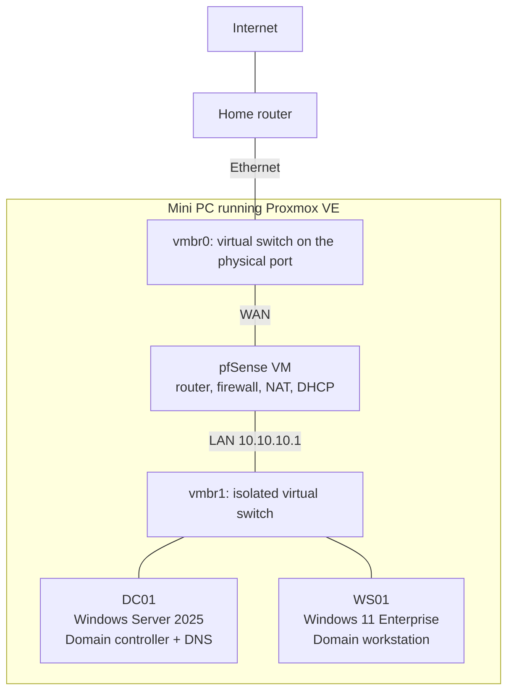
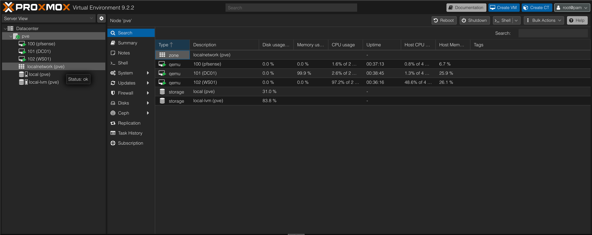
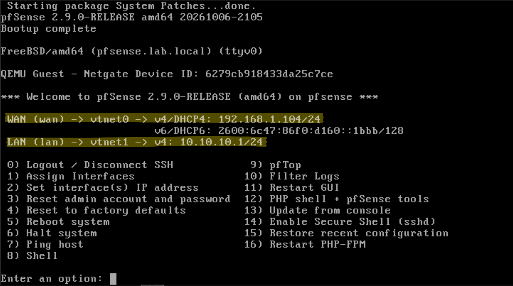
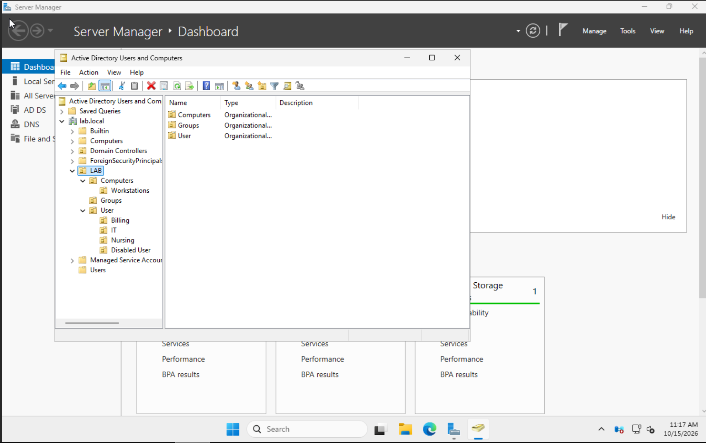
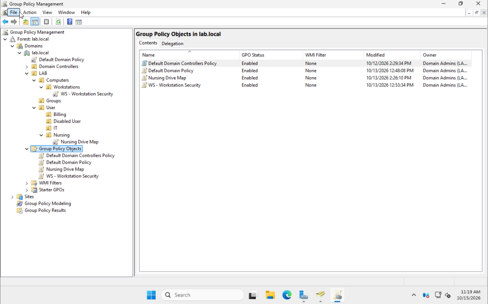
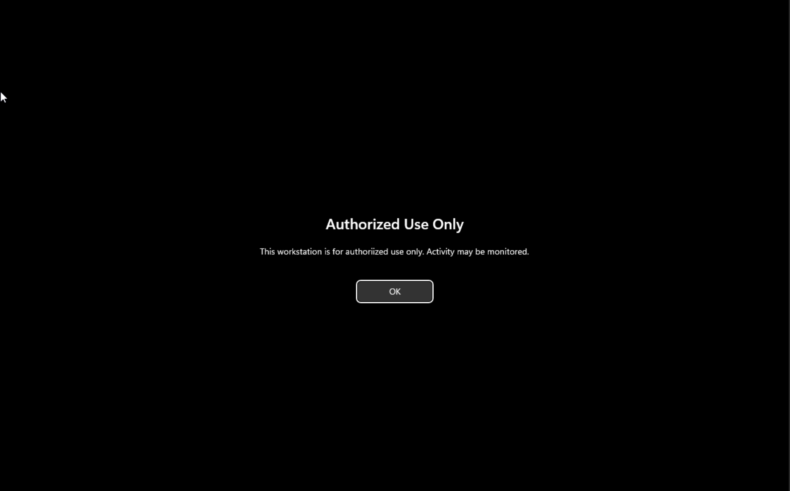
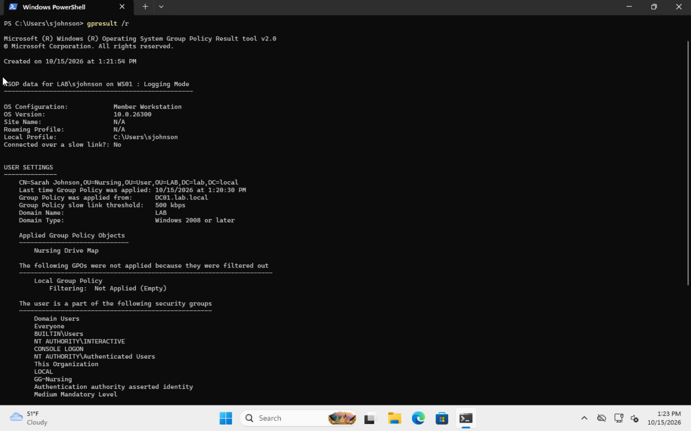
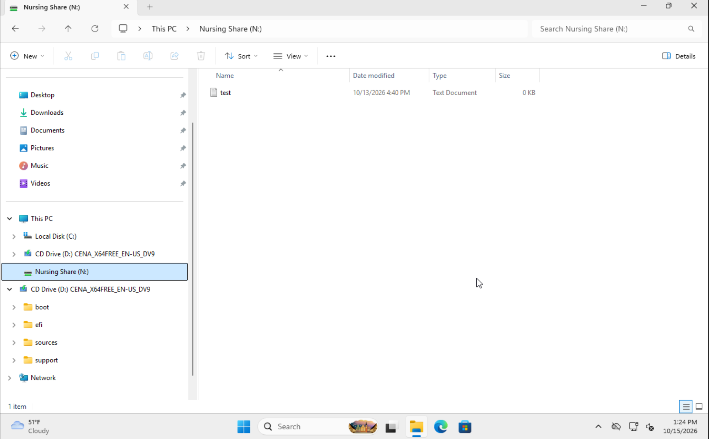
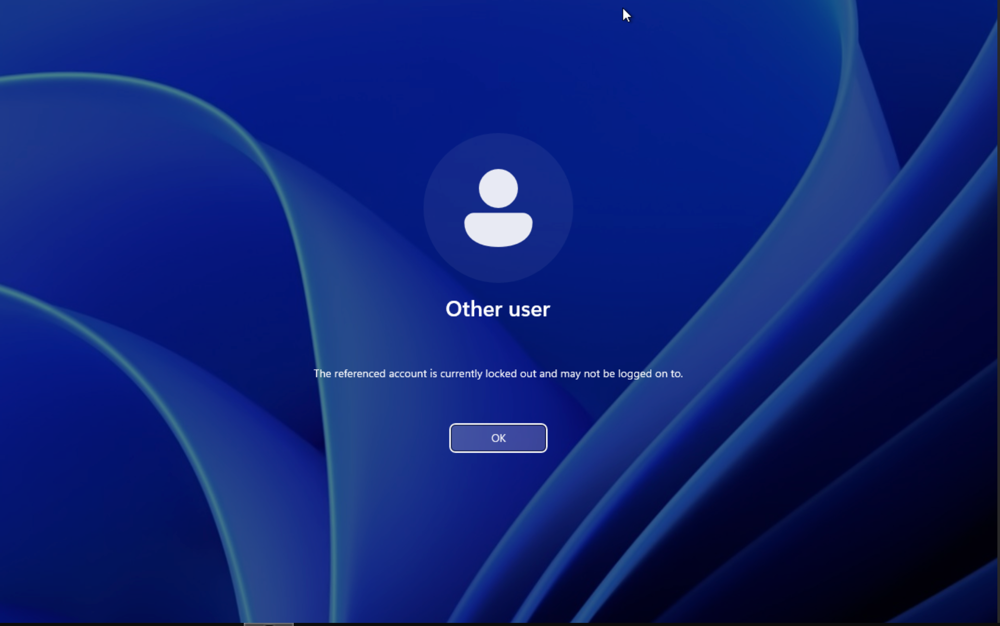
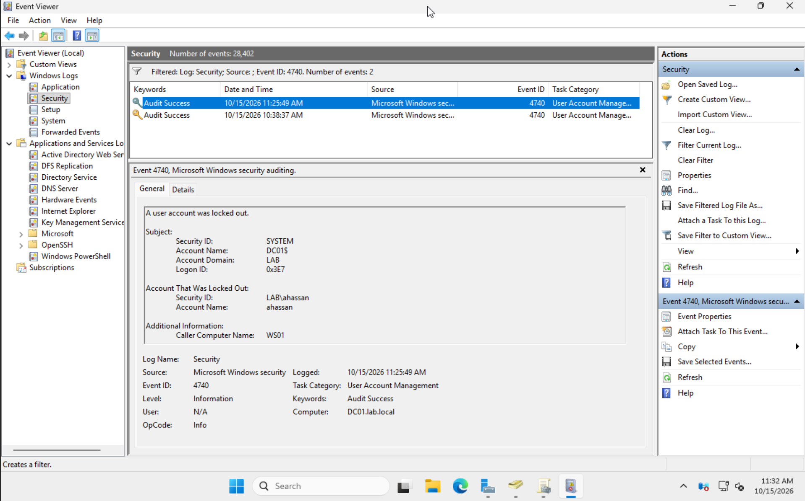

# Home Lab: Windows Active Directory Environment

A virtualized Windows domain built from scratch on a single mini PC. It includes a pfSense firewall, a Windows Server 2025 domain controller, a domain-joined Windows 11 workstation, Group Policy, and hands-on help desk scenarios.

I built this lab to practice the day-to-day work of help desk and system administrator roles, and to apply what I learned for the CCNA and CompTIA Security+.

---

## Skills demonstrated

- **Virtualization:** Proxmox VE (Type 1 hypervisor), virtual switches, snapshots
- **Networking:** pfSense routing, NAT, DHCP, network segmentation, subnet planning
- **Active Directory:** AD DS, DNS, OUs, security groups, user lifecycle
- **Group Policy:** password and lockout policy, workstation hardening, drive mapping
- **Security:** least privilege, NTFS and share permissions, account lockout, offboarding
- **Troubleshooting:** DNS, domain join, Group Policy, mapped drives
- **Tools:** ADUC, Group Policy Management, PowerShell, `gpresult`, `nslookup`, `net use`, Event Viewer

---

## Lab environment

**Hardware:** Intel N150 mini PC, 16 GB RAM, 256 GB SSD, managed from a MacBook over the home network.



The lab network (vmbr1) has no physical port, so all lab traffic must pass through pfSense. This keeps the lab isolated from my home network.

### Virtual machines

| VM | OS | RAM | Disk | Role |
|---|---|---|---|---|
| pfsense | pfSense CE | 1 GB | 10 GB | Router, firewall, DHCP for the lab |
| DC01 | Windows Server 2025 | 4 GB | 40 GB | Domain controller, DNS, file share |
| WS01 | Windows 11 Enterprise | 4 GB | 50 GB | Domain-joined workstation |

### IP plan

| Item | Value |
|---|---|
| Lab network | 10.10.10.0/24 |
| Gateway (pfSense LAN) | 10.10.10.1 |
| DC01 (static) | 10.10.10.10 |
| DHCP range | 10.10.10.100 to 10.10.10.200 |
| DNS for clients | 10.10.10.10 (DC01) |

I changed pfSense's default LAN (192.168.1.1) to 10.10.10.0/24 to avoid overlapping with the home network's subnet.

---

## Build summary

1. **Proxmox VE** installed on bare metal (ext4 to save RAM for VMs), switched to the no-subscription repository, and fully updated.
2. **Isolated lab bridge (vmbr1)** created with no physical port.
3. **pfSense** deployed with WAN on the home network and LAN on the lab network. Changed the default admin password and unblocked private networks on WAN (the "internet" side is a home network).
4. **DC01** installed with a static IP, patched, and promoted to a domain controller for a new forest, `lab.local`.
5. **DNS** configured: DC01 resolves the domain and forwards everything else to pfSense, pfSense DHCP hands out DC01 as the DNS server, and a pfSense domain override forwards `lab.local` queries to DC01.
6. **WS01** installed (UEFI, TPM 2.0, Secure Boot), joined to the domain, and moved into the Workstations OU.
7. **Snapshots** taken at each milestone for quick rollback.

---

## Active Directory design

```
lab.local
└── LAB
    ├── LAB Users
    │   ├── IT
    │   ├── Nursing
    │   └── Billing
    ├── LAB Computers
    │   └── Workstations
    ├── LAB Groups
    │   ├── GG-IT
    │   ├── GG-Nursing
    │   └── GG-Billing
    └── Disabled Users
```

- **Custom OUs** let me link Group Policies (the default Users and Computers containers can't have GPOs linked).
- **Security groups** control access, so permissions are granted to a group, not to individual users.
- **Separate admin account:** my everyday account has no admin rights, and a separate account in Domain Admins is used only for admin work (least privilege).
- **Users** were created in ADUC and with PowerShell:

```powershell
New-ADUser -Name "Mike Davis" -GivenName "Mike" -Surname "Davis" `
  -SamAccountName "mdavis" -UserPrincipalName "mdavis@lab.local" `
  -Path "OU=Nursing,OU=LAB Users,OU=LAB,DC=lab,DC=local" `
  -AccountPassword (Read-Host -AsSecureString "Password") `
  -Enabled $true -ChangePasswordAtLogon $true

Add-ADGroupMember -Identity "GG-Nursing" -Members "mdavis"
```

---

## Group Policy

| GPO | Linked to | Settings | Why |
|---|---|---|---|
| Default Domain Policy | Domain | 12-character minimum, complexity on; lockout after 5 failed attempts for 15 minutes | Slows down password guessing |
| WS - Workstation Security | Workstations OU | Screen locks after 5 minutes idle; "Authorized Use Only" logon banner | Protects unattended workstations (patient data, HIPAA) and gives legal notice of monitoring |
| Nursing Drive Map | Nursing OU | Maps N: to `\\DC01\Nursing` | Department share appears automatically for Nursing staff |

**Share permissions:** Share set to Everyone: Full Control, with access controlled by NTFS permissions (GG-Nursing: Modify). Effective access is the more restrictive of the two.

**Verified:** A Nursing user gets the N: drive and can create files; a Billing user is denied access.

---

## Troubleshooting log

| Problem | Diagnosis | Fix |
|---|---|---|
| `nslookup lab.local` returned "Non-existent domain" from pfsense.lab.local | The client was using pfSense for DNS, and pfSense doesn't know the AD domain | Set pfSense DHCP to hand out DC01 (10.10.10.10) as DNS, renewed the lease and flushed the DNS cache, and added a pfSense domain override for `lab.local` |
| Domain join option greyed out | A pending computer rename required a restart | Restarted, or joined with `Add-Computer` in PowerShell |
| Domain join failed: "The user's password must be changed" | The admin account had "must change password at next logon" set | Changed the password by signing in once with that account |
| N: drive not appearing; Event Viewer: "The network name cannot be found" | The server was reachable, but the drive map path didn't match the share name | Copied the exact UNC path from File Explorer into the drive map |
| `net use N:` returned system error 85 | N: was already mapped correctly; File Explorer hadn't refreshed | Confirmed with `net use` (Status OK) and refreshed This PC |

**Key lesson:** "The network *path* was not found" means the server can't be reached (network, DNS, or firewall). "The network *name* cannot be found" means the server answered but the share name is wrong.

---

## Help desk scenarios

| Ticket | Cause | Resolution |
|---|---|---|
| User locked out | 5 failed logons triggered the lockout policy | Unlocked in ADUC and with `Unlock-ADAccount`; found Event ID 4740 in the DC's Security log, which shows the source computer |
| Forgotten password | User request | Verified identity first (social engineering risk), then reset with "must change password at next logon" |
| Department transfer, no access to new share | Still in the old department's group; group changes apply at next logon | Moved the user to the Nursing OU, swapped group membership, signed out and back in; verified with Effective Access |
| Employee left the company | Offboarding | Disabled (not deleted) the account, removed group memberships, moved to Disabled Users; confirmed logon is refused |

```powershell
Search-ADAccount -LockedOut
Unlock-ADAccount -Identity mdavis
Set-ADAccountPassword -Identity ahassan -Reset -NewPassword (Read-Host -AsSecureString "Temp password")
Set-ADUser -Identity ahassan -ChangePasswordAtLogon $true
```

---

## Screenshots

| | |
|---|---|
| Proxmox dashboard |  |
| pfSense dashboard |  |
| AD OU structure |  |
| Group Policy links |  |
| Logon banner on WS01 |  |
| `gpresult /r` output |  |
| N: drive for a Nursing user |  |
| Access denied for a locked-out user |  |
| Lockout event 4740 |  |

---

## What I learned

- Active Directory depends on DNS. Most of my domain join and logon problems came down to which DNS server the client was using.
- Group Policy needs the right OU, the right side (user vs. computer settings), and often a sign-out to take effect.
- Reading the exact error message (and Event Viewer) narrows a problem down much faster than guessing.
- Snapshots before every risky change made it safe to experiment.

---

## Next steps

- [ ] Project 2: pfSense firewall rules and network segmentation
- [ ] Project 3: Wazuh SIEM with security alerts from the domain
- [ ] Project 4: Vulnerability scanning and remediation with Nessus
